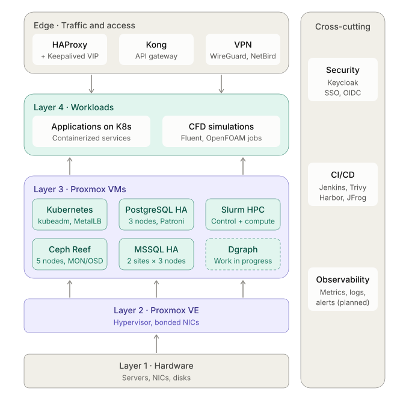
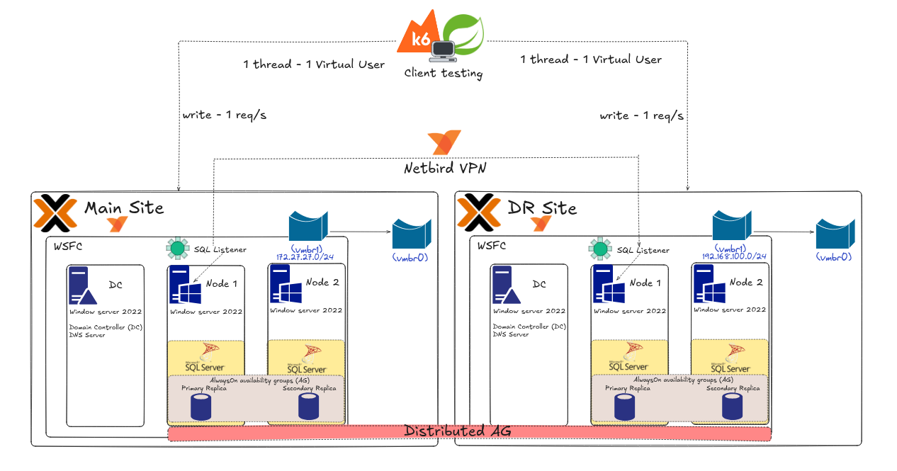
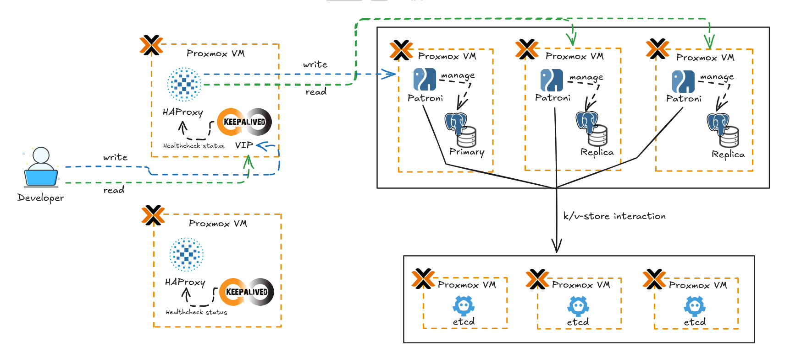

# Centralized Infrastructure & DevOps Configuration Repository

**Role:** DevOps / Infrastructure Engineering
**Focus:** Infrastructure as Code (IaC) & Distributed Systems

## Overview

This repository serves as the centralized source of truth for Infrastructure as Code, deployment manifests, and system configurations. It contains the operational code, scripts, and state files required to provision, configure, and maintain complex distributed environments, ranging from High Performance Computing (HPC) clusters to multi-site Disaster Recovery (DR) architectures.

The structure is organized by functional domain rather than by isolated tool, reflecting a system-oriented approach to infrastructure management.



*Overall platform architecture: traffic and access services feed workloads and platform stacks hosted on Proxmox VE and underlying hardware; security, CI/CD, and observability are cross-cutting concerns.*

## Domain Configurations & Managed Architectures

### 1. Database Clusters & Distributed Data

Stored artifacts: High Availability (HA) configurations, failover scripts, and replication topologies for SQL/NoSQL systems.

- **MSSQL High Availability** — Configurations for a multi-site DR topology (2 sites, 3 nodes per site) using [Windows Server Failover Clustering (WSFC)](https://learn.microsoft.com/en-us/windows-server/failover-clustering/failover-clustering-overview) and [Always On Availability Groups](https://learn.microsoft.com/en-us/sql/database-engine/availability-groups/windows/always-on-availability-groups-sql-server), including [Distributed Availability Group](https://learn.microsoft.com/en-us/sql/database-engine/availability-groups/windows/distributed-availability-groups) networking over VPN.

  

  *MSSQL Distributed Availability Group topology across the primary and DR sites.*

- **PostgreSQL HA** — Cluster manifests and configuration files for a 3-node HA setup using [Patroni](https://patroni.readthedocs.io/), [etcd](https://etcd.io/), and [Consul](https://developer.hashicorp.com/consul).

  

  *PostgreSQL high-availability topology coordinated by Patroni and etcd.*
- **Dgraph** — Deployment manifests for a distributed graph database architecture ([Dgraph](https://dgraph.io/)) — work in progress.

### 2. High Performance Computing (HPC)

Stored artifacts: workload manager configurations, node definitions, and job scheduling scripts.

- **Slurm Cluster** — Control node and compute node configuration files (`slurm.conf`, cgroups) using [Slurm Workload Manager](https://slurm.schedmd.com/) for CFD simulation workloads.
- **Simulation Workloads** — Resource allocation scripts for [Ansys Fluent 2022 R1](https://www.ansys.com/products/fluids/ansys-fluent) and [OpenFOAM](https://www.openfoam.com/) on Rocky Linux.

### 3. Traffic Management & Networking

Stored artifacts: proxy routing rules, overlay network configurations, and load balancer definitions.

- **Load Balancing** — [HAProxy](https://www.haproxy.org/) routing configurations and [Keepalived](https://www.keepalived.org/) (VRRP) definitions for stateful failover.
- **VPN Tunneling** — Routing tables and peer configurations for self-hosted [NetBird](https://netbird.io/) and [WireGuard](https://www.wireguard.com/) site-to-site connections.
- **Network Bonding** — LACP and active-backup bonding configurations for [Proxmox VE](https://www.proxmox.com/en/proxmox-virtual-environment/overview) hypervisors.
- **API Gateway** — [Kong API Gateway](https://konghq.com/products/kong-gateway) declarative routing and plugin configurations.

### 4. Storage Systems

Stored artifacts: storage topology maps, daemon configurations, and disaster recovery scripts.

- **Ceph Reef (v18.2.7)** — [`ceph.conf`](https://docs.ceph.com/en/reef/) and deployment specs for a 5-node distributed cluster (MON, OSD, RGW), including custom [CRUSH map](https://docs.ceph.com/en/reef/rados/operations/crush-map/) definitions, Placement Group (PG) tuning, and automated fault-tolerance testing scripts.

### 5. Kubernetes & DevSecOps

Stored artifacts: YAML manifests, Helm values, and CI/CD pipeline definitions.

- **Cluster Ops** — [kubeadm](https://kubernetes.io/docs/reference/setup-tools/kubeadm/) initialization configs and [MetalLB](https://metallb.universe.tf/) (Layer 2) routing manifests.
- **CI/CD Pipelines** — Declarative [Jenkinsfiles](https://www.jenkins.io/doc/book/pipeline/jenkinsfile/) integrated with [Trivy](https://trivy.dev/) (security scanning), [Harbor](https://goharbor.io/) (registry), and [JFrog Artifactory](https://jfrog.com/artifactory/) (artifact storage).
- **Optimization** — Custom DaemonSet manifests for cluster-wide node maintenance and automated image pruning.

### 6. Security & Identity Management

Stored artifacts: access policies, realm configurations, and TLS management.

- **Keycloak** — JSON realm exports and configurations for [Keycloak](https://www.keycloak.org/) SSO/OIDC integration across internal infrastructure services.

## Repository Structure

```text
devops-lab/
├── database-clusters/           # Patroni YAMLs, Postgres conf, MSSQL AG scripts
├── high-performance-computing/  # slurm.conf, munge keys, Ansys job bash scripts
├── traffic-network/             # haproxy.cfg, keepalived.conf, wireguard wg0.conf
├── storage-systems/             # ceph.conf, CRUSH maps, RGW tuning parameters
├── kubernetes-ecosystem/        # K8s YAML manifests, Jenkinsfiles, Helm values
├── security-identity/           # Keycloak realm exports, OIDC configurations
├── virtualization-hardware/     # Proxmox /etc/network/interfaces, bond configs
└── docs/                        # Architecture diagrams (Draw.io/Mermaid) & reports
```
